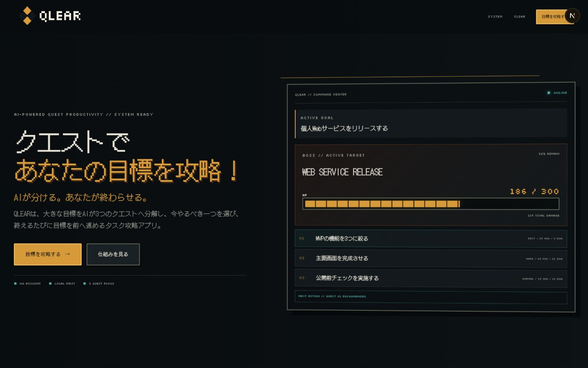
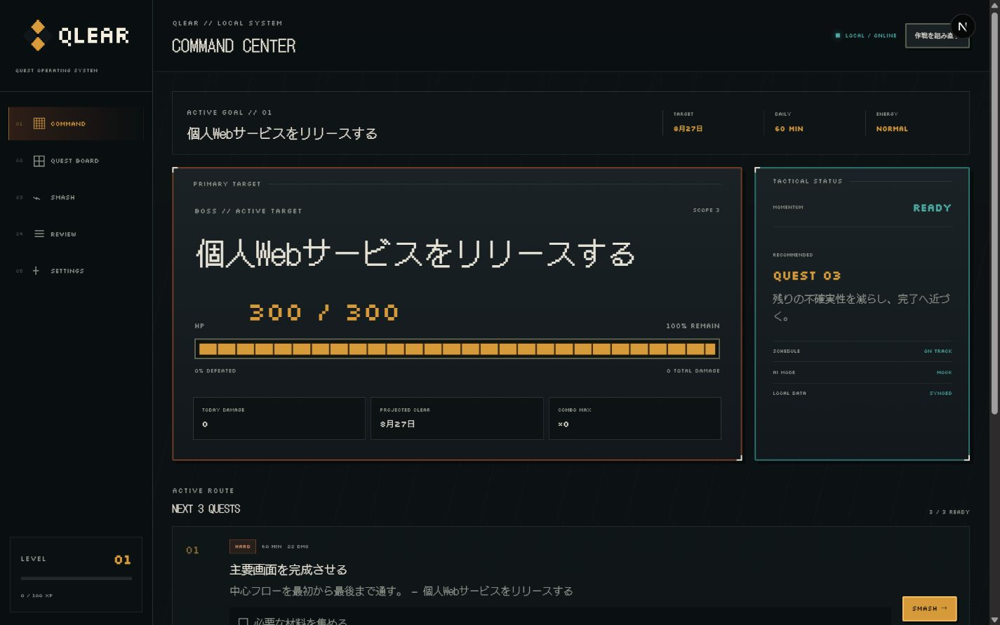
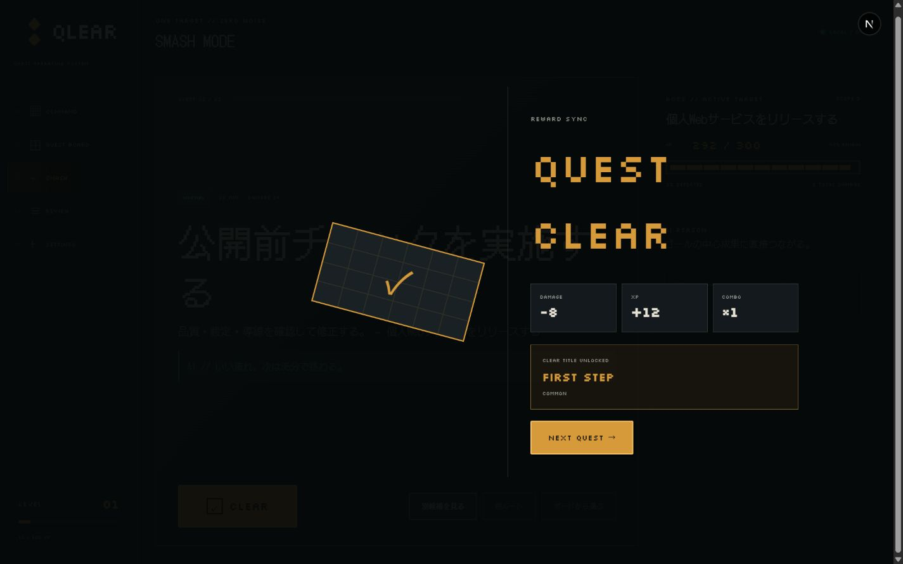
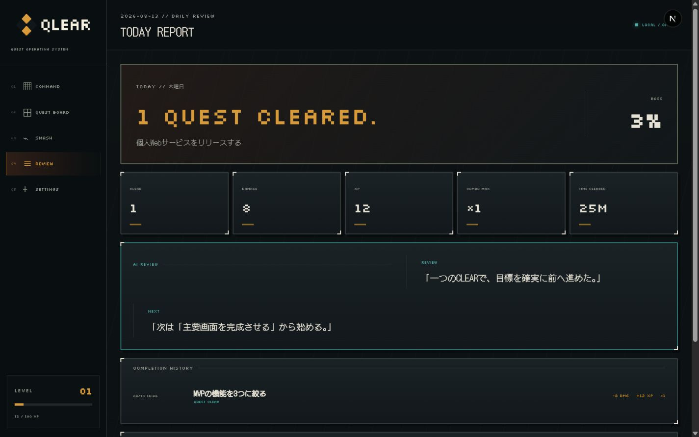
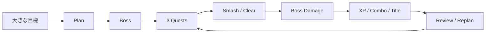
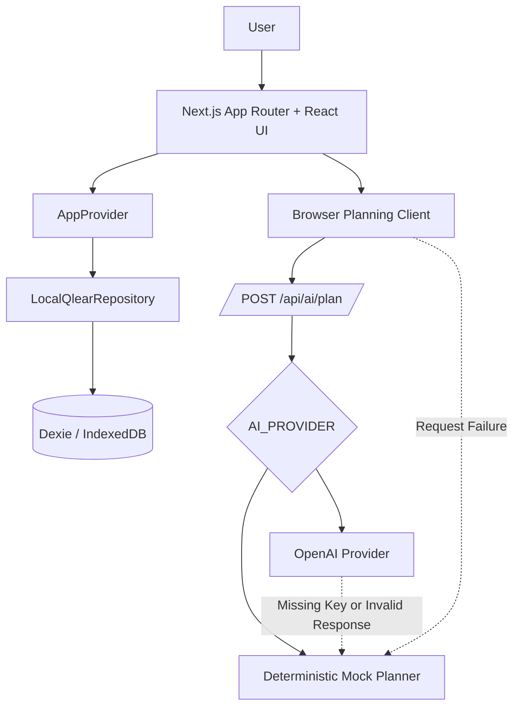

<div align="center">
  

  # QLEAR

  **大きな目標を、今日終えられる3つの行動へ。**

  **AIが分ける。あなたが終わらせる。**

  ポートフォリオプロジェクト — 開発中 · 個人利用を優先 · ローカルファースト

  [English](./README.md) | **日本語**

  [🌐 **Live Demo**](https://qlear.vercel.app/)

  🎯 **3つのQuestに集中** · 🤖 **AIによる計画支援** · 💾 **ローカルファースト**
</div>

## 👾 QLEARとは

QLEARは、大きな個人目標を攻略するためのQuest型生産性アプリです。1つの目標を編集可能な3つのQuestへ変換し、一度に1つへ集中できる状態をつくり、完了するたびにBossへDamageを与えて進捗を見える形にします。

原点にあるのは、紙のToDoリストで最後の項目にチェックを入れ、その紙を丸めたときの心地よさです。多くのデジタルToDoアプリにはチェックボックスはあっても、仕事を終えた実感までは残りにくい。QLEARは、Digital Crumpleという完了演出、目に見える進捗、小さな報酬を通して、その感覚をデジタルに取り戻そうとしています。

現在のQLEARは個人利用を前提にしたポートフォリオプロジェクトで、Vercel上に公開デモがあります。アカウントやクラウド同期は不要で、主要データは各利用者のブラウザ内に保存されます。

## 🖼 プレビュー

<table>
  <tr>
    <td width="50%">
      
      <br /><sub><strong>Landing</strong> — プロダクトの価値と3 Questの考え方。</sub>
    </td>
    <td width="50%">
      
      <br /><sub><strong>Command Center</strong> — Boss HP、戦術情報、現在の攻略ルート。</sub>
    </td>
  </tr>
  <tr>
    <td width="50%">
      
      <br /><sub><strong>Smash / Clear</strong> — 完了をDamage、XP、Combo、Title解除へつなげます。</sub>
    </td>
    <td width="50%">
      
      <br /><sub><strong>Review</strong> — 今日の数値、次の行動、完了履歴、Title Archive。</sub>
    </td>
  </tr>
</table>

## ✨ なぜQLEARなのか

- **完了そのものが気持ちよくあるべき。** CLEARを単なる状態変更ではなく、設計された体験として扱います。
- **一度に取り組むのは1つ。** Smash Modeでは、現在のQuest以外のノイズを抑えます。
- **終わりのない一覧ではなく3 Quest。** 生成・再計画されるルートは、必ず編集可能な3件で構成されます。
- **進捗を目で確認できる。** 難易度がDamageへ反映され、CLEARのたびにBoss HPが減ります。
- **実用的なローカルファースト。** 主要データをブラウザ内に保存し、検証済みJSONとして書き出し・復元できます。
- **AIは作業の裏側に置く。** チャット画面ではなく、Quest、見積もり、提案理由という形で計画を返します。

## 🎯 機能

### 計画

- 目標、任意の期限、1日の作業時間、Energyを入力するGoal Setup
- 既定のMock Plannerによる、再現可能で編集可能な3 Questの生成
- Scope、難易度、所要時間、優先度、Damage、Schedule、任意のSubquestの計画

### 実行

- Boss HP、おすすめQuest、今日のDamage、Comboを表示するCommand Center
- `READY`、`IN_PROGRESS`、`CLEARED`の状態管理と詳細編集に対応したQuest Board
- 最大3件から選択できるSmash Mode、より小さな別ルート提案、変更のUndo
- Boss Damage、XP、Session Combo、Level、条件付きTitle解除を伴うDigital Crumple

### 進捗とデータ

- 今日の集計、次の行動、完了履歴、Title Archiveを確認できるReview
- Dexie / IndexedDBによるローカル保存、検証付きJSON Import / Export、Reset
- AnimationとReduced Effectsの設定
- 日本語のビットマップフォントを使った、ピクセルアート調のダークUI

### 🤖 現在のAIの動作

> [!NOTE]
> QLEARは既定でDeterministic Mock Plannerを使用します。OpenAI連携は任意で、現在は初回Planningのみを担当します。Replan、より小さな代替案、Daily Reviewは決定的またはローカルな処理です。
>
> 公開中のVercelデモは現在 `AI_PROVIDER=mock` で動作しており、OpenAI APIの呼び出しやAPI Keyを必要としません。

QLEARは、既定で決定的なMock Plannerを使用します。そのため、API Keyがなくてもローカル開発と主要フロー全体を利用できます。加えて、初回のGoal Planningには、OpenAI Responses APIを呼び出すServer-onlyのOpenAI Providerも実装されています。

`AI_PROVIDER=openai`かつ`OPENAI_API_KEY`が設定されている場合、初回のPlan生成は、構造化出力とZod検証を伴うOpenAI Providerを使用します。Keyがない場合、Provider Errorが起きた場合、またはResponseが不正な場合は、決定的なMock PlannerへFallbackします。現在の実装では、再計画と小さな別ルートの提案はMock Pathを使い、Daily Reviewは完了データからローカルで算出します。つまり、OpenAI連携は任意であり、AIと表示されるすべての画面を現在のOpenAI Providerが処理しているわけではありません。

## 🔁 コアループ



## 🧱 アーキテクチャ

QLEARは、1つのNext.js App Routerアプリケーションです。Domain DataはブラウザのIndexedDBへ保存し、任意のOpenAI PlanningだけがServer Routeを通ります。



完了処理では、演出が始まる前にQuest Status、Boss HP、Completion Event、Reward、Titleを1つのTransactionで保存します。OpenAI SDKとAPI KeyはServer Sideの外へ出しません。

## 🛠 技術スタック

| 分類 | 技術 |
| --- | --- |
| Framework / UI | Next.js 16 App Router、React 19、TypeScript、Tailwind CSS 4 |
| Client State | Application Data用のReact Context、短期的なUI State用のZustand |
| Validation | Zod 4 |
| Persistence | Browser IndexedDB上のDexie 4 |
| AI | Deterministic Mock Planner、任意のServer-only OpenAI Provider、Responses API連携 |
| Testing | Vitest、Testing Library、fake-indexeddb、Playwright |
| Deployment / Hosting | Vercel |
| Tooling | pnpm、ESLint、PostCSS |

## 🚀 はじめ方

### 必要環境

- Node.js 20.9以上（導入済みのNext.js Versionが要求）
- pnpm 11.16.0（`package.json`で固定）

### Installと起動

```bash
pnpm install
```

ローカル用のEnvironment Fileを作成します。

```bash
# macOS / Linux
cp .env.example .env.local
```

```powershell
# Windows PowerShell
Copy-Item .env.example .env.local
```

Development Serverを起動します。

```bash
pnpm dev
```

[http://localhost:3000](http://localhost:3000)を開きます。Example ConfigurationはMock Modeのため、API Keyは不要です。

## 🔐 環境変数

通常のローカル設定で使用する環境変数は、[`.env.example`](./.env.example)に存在するものだけです。

| 変数 | 役割 |
| --- | --- |
| `AI_PROVIDER` | 初回PlanのProviderを選択します。`openai`でOpenAI Pathを有効にし、それ以外はDeterministic Mockを使います。Exampleの既定値は`mock`です。 |
| `OPENAI_API_KEY` | 任意のOpenAI Providerで使うServer-only Credentialです。Mock Modeでは空欄のままで構いません。 |
| `OPENAI_MODEL` | OpenAI Providerを有効にしたとき、Responses APIへ渡すModel IDです。 |
| `NEXT_PUBLIC_FAST_MODE` | `true`の場合、Setupの段階的なAnimationを短縮します。高速なローカル確認や自動テスト向けです。 |

実際のCredentialはCommitしないでください。OpenAIの設定が不足している場合やProviderが失敗した場合、初回PlanningはMock PlannerへFallbackします。

## ⌨️ 利用できるScripts

| Command | 役割 |
| --- | --- |
| `pnpm dev` | Next.js Development Serverを起動します。 |
| `pnpm build` | Production Buildを作成します。 |
| `pnpm start` | 作成済みのProduction Buildを配信します。 |
| `pnpm lint` | Repository全体へESLintを実行します。 |
| `pnpm typecheck` | Fileを出力せず、StrictなTypeScript Checkを実行します。 |
| `pnpm test` | VitestのUnit、Component、Integration Testを1回実行します。 |
| `pnpm test:watch` | VitestをWatch Modeで起動します。 |
| `pnpm test:e2e` | AppをBuildし、Playwright ChromiumのE2E Suiteを実行します。 |

## 🗂 プロジェクト構成

```text
src/
├── app/        # App RouterのPage、Layout、Global Style、API Route
├── frontend/   # UI Component、Feature Module、Client State
├── backend/    # AI Provider、IndexedDB Schema、Repository Layer
└── shared/     # Domain Logic、Type、Validation、Utility

tests/
├── unit/       # Pure Domain、Validation、Component Test
├── integration/ # RepositoryとIndexedDBのBehavior
└── e2e/        # PlaywrightのProduct FlowとLayout Regression Test
```

詳細は[Project Structure](./docs/PROJECT_STRUCTURE.md)、Architecture・Data Model・AI・Design・Requirements・Testingの資料は[Documentation](./docs/README.md)を参照してください。

## 🧠 設計上の判断

**Questを必ず3件にする**  
Planを確認しやすくし、実行可能な大きさにActive Routeを保つためです。

**Chatbotにしない**  
AIの出力を編集可能なProduct Objectへ変換し、最終的な主導権をUser側に残します。

**Local-firstで保存する**  
登録や外部保存なしでも個人利用を成立させ、Import / Exportで手動の持ち運びを可能にします。

**Boss HPで進捗を表す**  
大きな目標を、完了した仕事によって減っていく量へ置き換えます。

**完了をTransactionとInteractionの両方として扱う**  
Digital Crumpleより先に永続化することで、Animation Failureが進捗を消さないようにします。

**MockとProviderの境界を分ける**  
開発とTestを再現可能にしつつ、任意のProvider-backed PlanningをServer-onlyで追加できる構造にしています。

## 🧪 テストと品質

Vitestでは、Deterministic Planning、Schema Validation、Scheduling、Gamification、読み取り可能なProgress表示、IndexedDB Repository Transactionを確認します。Playwrightでは、Desktop Landing、Goal → Plan → CLEAR、Reload後のPersistence、Alternative、Replan、Settings、Browser Console Errorを確認します。

ローカルでQuality Gate全体を実行するCommandは次のとおりです。

```bash
pnpm lint
pnpm typecheck
pnpm test
pnpm test:e2e
pnpm build
```

## 🗺 ロードマップ

> [!IMPORTANT]
> 以下は現在実装済みの機能ではなく、今後の候補です。

- Provider-backedなAdaptive PlanningをReplan、Alternative、Reviewまで拡張
- Local-first Modeを維持した、任意のAuthenticationとCloud Sync
- 個人向けWorkflowを成熟させた後のShared GoalまたはTeam Workflowの検討
- Review Analyticsと長期Progress Viewの拡充
- 短いGIFまたはInteractiveなProduct Walkthroughの追加

## 👤 作者

| 項目 | 内容 |
| --- | --- |
| **GitHub** | [@zahin-dev](https://github.com/zahin-dev) |
| **学年** | 学部3年 |
| **学部** | 情報学部 |
| **学科** | 情報システム学科 |
| **卒業予定** | 2028年卒（28卒） |

## 📄 ライセンス

QLEARは[MIT License](./LICENSE)のもとで公開されています。
