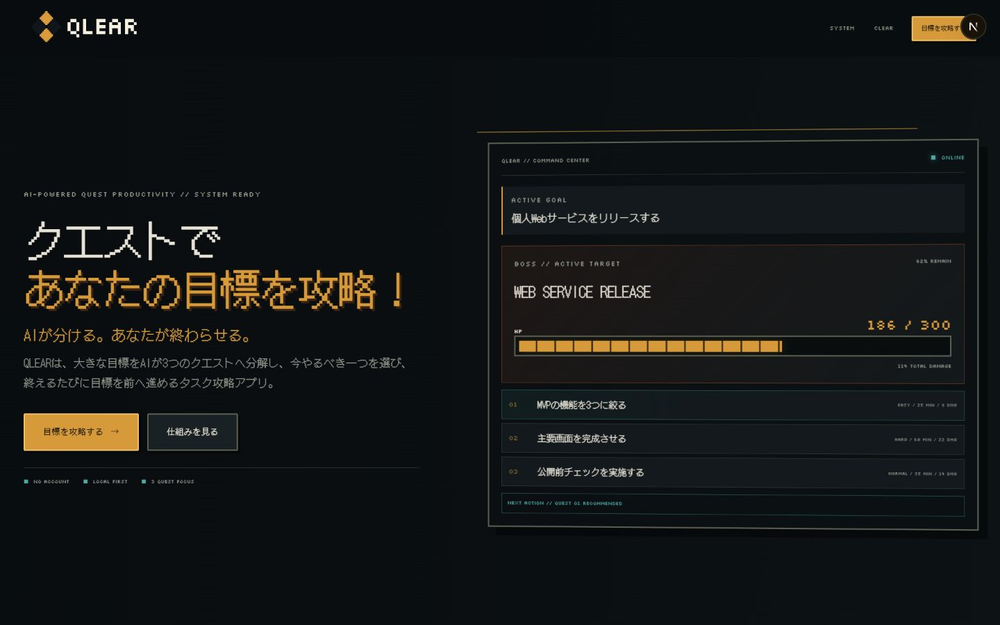
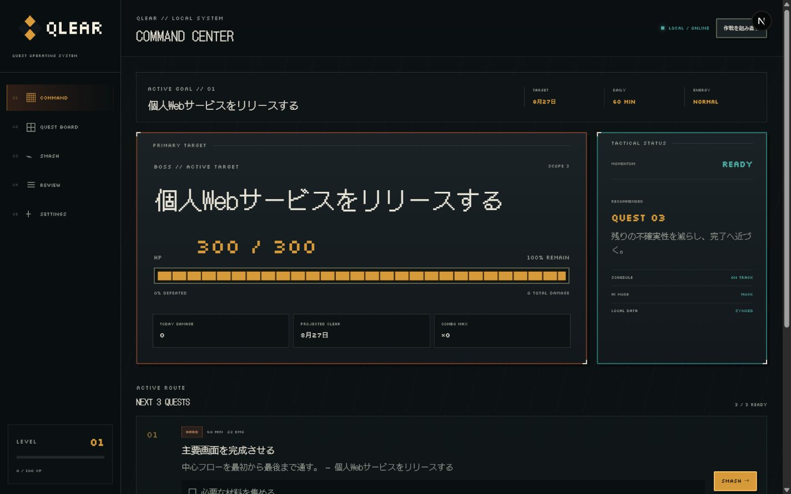
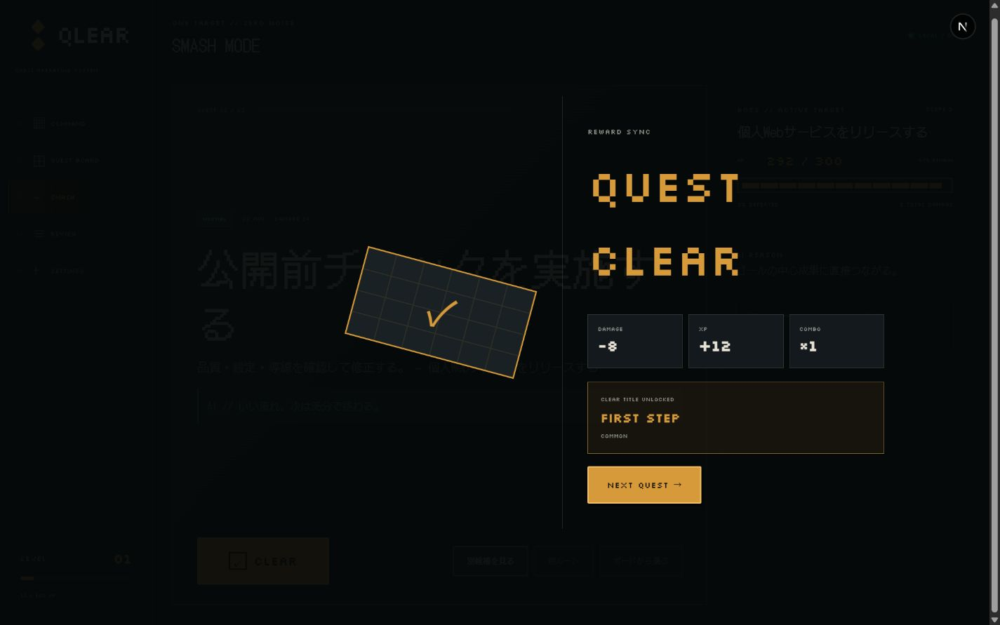
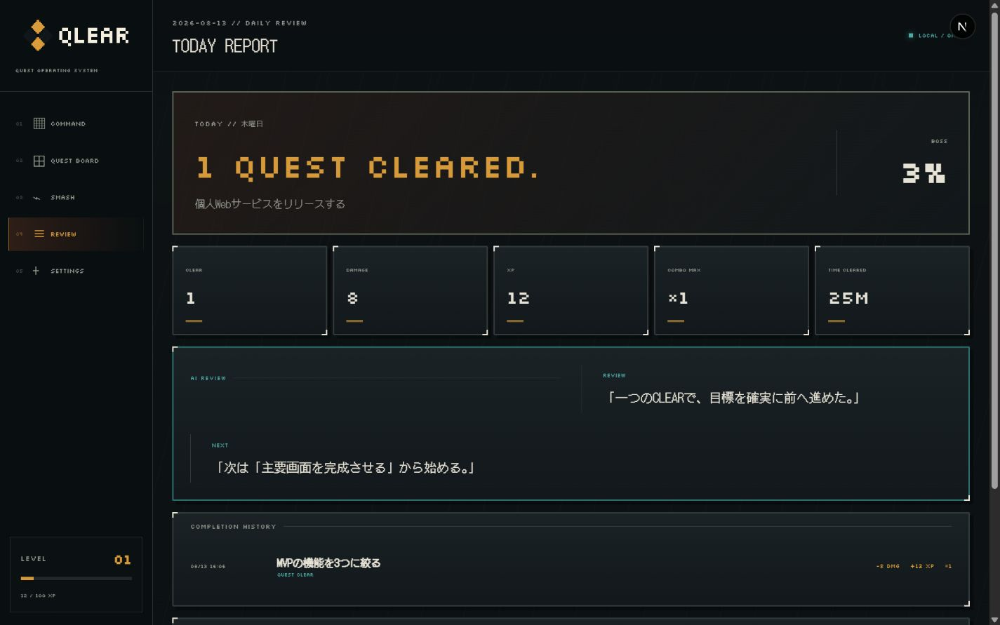
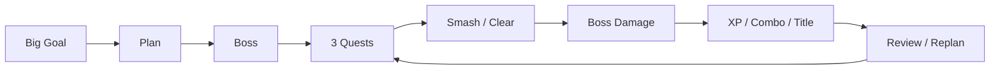
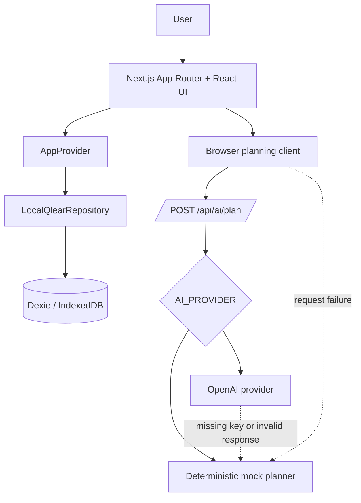

<div align="center">
  

  # QLEAR

  **Turn big goals into three things you can finish today.**

  **AI breaks it down. You clear it.**

  Portfolio project — actively developed · Personal-use first · Local-first

  **English** | [日本語](./README.ja.md)

  🎯 **3-Quest Focus** · 🤖 **AI-assisted Planning** · 💾 **Local-first**
</div>

## 👾 What is QLEAR?

QLEAR is a goal attack / quest productivity app. It turns one large personal goal into an editable three-quest route, helps you focus on one quest at a time, and makes every completion visibly reduce the goal through Boss damage.

The idea came from a small but memorable moment: checking the last item on a paper ToDo list, then crumpling the page, felt genuinely satisfying. Most digital task apps preserve the checkbox but lose that sense of closure. QLEAR explores how to bring it back through a deliberate Digital Crumple interaction, visible progress, and lightweight rewards.

QLEAR is currently a portfolio project built for personal local use. It does not require an account, has no cloud sync, and has no public live demo.

## 🖼 Preview

<table>
  <tr>
    <td width="50%">
      
      <br /><sub><strong>Landing</strong> — the product promise and three-quest concept.</sub>
    </td>
    <td width="50%">
      
      <br /><sub><strong>Command Center</strong> — Boss HP, tactical status, and the active route.</sub>
    </td>
  </tr>
  <tr>
    <td width="50%">
      
      <br /><sub><strong>Smash / Clear</strong> — completion becomes damage, XP, combo, and a possible title unlock.</sub>
    </td>
    <td width="50%">
      
      <br /><sub><strong>Review</strong> — daily metrics, the next action, completion history, and title archive.</sub>
    </td>
  </tr>
</table>

## ✨ Why QLEAR

- **Completion should feel good.** CLEAR is treated as a designed interaction, not only a status change.
- **One thing at a time.** Smash Mode removes the noise around the current quest.
- **Three quests, not an endless backlog.** Generated and replanned routes contain exactly three editable quests.
- **Progress should be visible.** Difficulty maps to damage, and every CLEAR reduces Boss HP.
- **Local-first should be practical.** Core data lives in the browser and can be exported or restored as validated JSON.
- **AI should stay behind the work.** Planning appears as structured quests, estimates, and reasoning rather than a chat window.

## 🎯 Features

### Planning

- Goal setup with optional target date, daily time budget, and energy level
- Default mock planning that deterministically produces exactly three editable quests
- Scope, difficulty, time estimate, priority, damage, schedule, and optional subquest planning

### Execution

- Command Center with Boss HP, recommended quest, daily damage, and combo status
- Quest Board with `READY`, `IN_PROGRESS`, and `CLEARED` states plus full quest editing
- Smash Mode with up to three active candidates, smaller-step alternatives, and undo
- Digital Crumple completion sequence with Boss damage, XP, session combo, levels, and cosmetic titles

### Progress & Data

- Daily review metrics, completion history, next-action guidance, and title archive
- Local persistence through Dexie and IndexedDB, including validated JSON export/import and reset controls
- Animation and reduced-effects settings
- Pixel-art-inspired dark interface with Japanese bitmap typography

### 🤖 Current AI Behavior

> [!NOTE]
> QLEAR uses the deterministic mock planner by default. The OpenAI integration is optional and currently powers initial planning only; replanning, smaller-step alternatives, and daily review still use deterministic or local logic.

QLEAR defaults to a deterministic mock planner, so local development and the complete core flow work without an API key. The repository also includes a server-only OpenAI provider for initial goal planning through the OpenAI Responses API.

When `AI_PROVIDER=openai` and `OPENAI_API_KEY` is configured, the initial plan request uses that provider with structured output and Zod validation. A missing key, provider error, or invalid response falls back to the deterministic planner. In the current implementation, replanning and smaller-step alternatives use the deterministic mock path, while the daily review is derived locally from completion data. The OpenAI path is therefore optional and does not power every AI-labelled surface yet.

## 🔁 Core Loop



## 🧱 Architecture

QLEAR is one Next.js App Router application. Domain data stays in browser IndexedDB; only optional OpenAI planning crosses a server route boundary.



Completion is committed transactionally before the visual sequence begins: quest status, Boss HP, completion event, rewards, and title state are persisted together. The OpenAI SDK and API key remain on the server side.

## 🛠 Tech Stack

| Area | Technology |
| --- | --- |
| Framework and UI | Next.js 16 App Router, React 19, TypeScript, Tailwind CSS 4 |
| Client state | React Context for application data, Zustand for ephemeral UI state |
| Validation | Zod 4 |
| Persistence | Dexie 4 over browser IndexedDB |
| AI | Deterministic mock planner; optional server-only OpenAI provider and Responses API integration |
| Testing | Vitest, Testing Library, fake-indexeddb, Playwright |
| Tooling | pnpm, ESLint, PostCSS |

## 🚀 Getting Started

### Prerequisites

- Node.js 20.9 or later (required by the installed Next.js version)
- pnpm 11.16.0 (pinned in `package.json`)

### Install and run

```bash
pnpm install
```

Create your local environment file:

```bash
# macOS / Linux
cp .env.example .env.local
```

```powershell
# Windows PowerShell
Copy-Item .env.example .env.local
```

Start the development server:

```bash
pnpm dev
```

Open [http://localhost:3000](http://localhost:3000). The example configuration uses mock mode, so no API key is needed.

## 🔐 Environment Variables

Only the variables present in [`.env.example`](./.env.example) are required or supported for normal local configuration.

| Variable | Purpose |
| --- | --- |
| `AI_PROVIDER` | Selects the initial-plan provider. `openai` enables the OpenAI path; any other value uses the deterministic mock. The example defaults to `mock`. |
| `OPENAI_API_KEY` | Server-only credential for the optional OpenAI provider. It may remain blank in mock mode. |
| `OPENAI_MODEL` | Model identifier passed to the OpenAI Responses API when the OpenAI provider is enabled. |
| `NEXT_PUBLIC_FAST_MODE` | When `true`, shortens the staged setup animation; useful for fast local or automated flows. |

Do not commit real credentials. If OpenAI configuration is incomplete or the provider fails, initial planning falls back to the mock planner.

## ⌨️ Available Scripts

| Command | Purpose |
| --- | --- |
| `pnpm dev` | Start the Next.js development server. |
| `pnpm build` | Create a production build. |
| `pnpm start` | Serve an existing production build. |
| `pnpm lint` | Run ESLint across the repository. |
| `pnpm typecheck` | Run strict TypeScript checking without emitting files. |
| `pnpm test` | Run the Vitest unit, component, and integration suites once. |
| `pnpm test:watch` | Run Vitest in watch mode. |
| `pnpm test:e2e` | Build the app and run the Playwright Chromium end-to-end suite. |

## 🗂 Project Structure

```text
src/
├── app/        # App Router pages, layout, global styles, and API route
├── frontend/   # UI components, feature modules, and client state
├── backend/    # AI providers, IndexedDB schema, and repository layer
└── shared/     # Domain logic, types, validation, and utilities

tests/
├── unit/       # Pure domain, validation, and component tests
├── integration/ # Repository and IndexedDB behavior
└── e2e/        # Playwright product flows and layout regression tests
```

See [Project Structure](./docs/PROJECT_STRUCTURE.md) for the detailed layout and [Documentation](./docs/README.md) for the architecture, data model, AI, design, requirements, and testing notes.

## 🧠 Engineering Decisions

**Exactly three quests**  
The constraint makes a plan reviewable and keeps the active route small enough to act on.

**AI without a chatbot**  
QLEAR turns planning output into editable product objects so the user stays in control.

**Local-first persistence**  
Personal use remains useful without registration or external data storage; export/import provides manual portability.

**Boss HP as an abstraction**  
One large goal becomes a visible quantity that decreases with completed work.

**Completion as a transaction and an interaction**  
Durable state is written before Digital Crumple begins, so animation failure cannot erase progress.

**Mock plus provider boundary**  
Deterministic output keeps development and tests reproducible while preserving a server-only path for optional provider-backed planning.

## 🧪 Testing & Quality

Vitest covers deterministic planning, schema validation, scheduling, gamification, accessible progress output, and IndexedDB repository transactions. Playwright covers the desktop landing experience, the Goal → Plan → CLEAR flow, reload persistence, alternatives, replanning, settings, and browser console failures.

Run the full local quality gate with:

```bash
pnpm lint
pnpm typecheck
pnpm test
pnpm test:e2e
pnpm build
```

## 🗺 Roadmap

> [!IMPORTANT]
> The following items are future work and are not current functionality.

- Extend provider-backed adaptive planning to replanning, alternatives, and review
- Add optional authentication and cloud sync while preserving a local-first mode
- Explore shared goals or team workflows after the personal workflow is mature
- Expand review analytics and longer-term progress views
- Add a concise GIF or interactive product walkthrough

## 👤 Author

| | |
| --- | --- |
| **GitHub** | [@zahin-dev](https://github.com/zahin-dev) |
| **Status** | 3rd-year undergraduate student |
| **Faculty** | Faculty of Informatics |
| **Department** | Department of Information Systems |
| **Expected Graduation** | 2028 |

## 📄 License

QLEAR is available under the [MIT License](./LICENSE).
