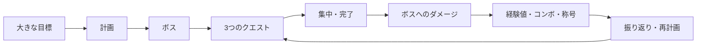
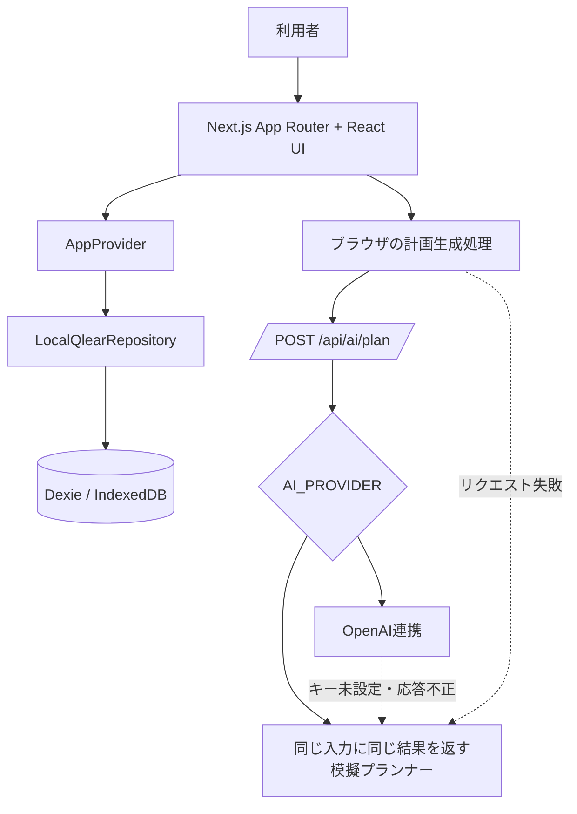

<div align="center">
  

  # QLEAR

  **大きな目標を、今日終えられる3つの行動へ。**

  **AIが分ける。あなたが終わらせる。**

  ポートフォリオプロジェクト · 個人利用を優先 · ローカルファースト

  [🌐 **公開デモ**](https://qlear.vercel.app/)

  🎯 **3つのクエストに集中** · 🤖 **AIによる計画支援** · 💾 **ローカルファースト**
</div>

<p align="center">
  <a href="#development">開発・公開状況</a> ·
  <a href="#screenshots">プレビュー</a> ·
  <a href="#features">機能</a> ·
  <a href="#quickstart">はじめ方</a>
</p>

---

<a id="development"></a>

## 開発・公開状況

| 項目 | 内容 |
| --- | --- |
| 開発開始 | 2025年4月 |
| MVP完成 | 2025年6月 |
| 現在の状況 | 開発停止 |
| GitHub初回公開 | 2026年8月 |
| 公開デモ | [QLEARを開く](https://qlear.vercel.app/) |

## 👾 QLEARとは

QLEARは、大きな個人目標を攻略するためのクエスト形式の目標管理アプリです。1つの目標を編集可能な3つのクエストへ変換し、一度に1つへ集中できる状態をつくり、完了するたびにボスへダメージを与えて進捗を見える形にします。

原点にあるのは、紙のToDoリストで最後の項目にチェックを入れ、その紙を丸めたときの心地よさです。多くのデジタルToDoアプリにはチェックボックスはあっても、仕事を終えた実感までは残りにくい。QLEARは、紙を丸める動きを取り入れた完了演出、目に見える進捗、小さな報酬を通して、その感覚をデジタルに取り戻そうとしています。

現在のQLEARは個人利用を前提にしたポートフォリオプロジェクトで、Vercel上に公開デモがあります。アカウントやクラウド同期は不要で、主要データは各利用者のブラウザ内に保存されます。

<a id="screenshots"></a>

## 🖼 プレビュー

<table>
  <tr>
    <td width="50%">
      
      <br /><sub><strong>トップページ</strong> — プロダクトの価値と3つのクエストの考え方。</sub>
    </td>
    <td width="50%">
      
      <br /><sub><strong>進捗ダッシュボード</strong> — ボスのHP、戦術情報、現在の攻略ルート。</sub>
    </td>
  </tr>
  <tr>
    <td width="50%">
      
      <br /><sub><strong>集中・完了画面</strong> — 完了をダメージ、経験値、コンボ、称号の獲得につながります。</sub>
    </td>
    <td width="50%">
      
      <br /><sub><strong>振り返り</strong> — 今日の数値、次の行動、完了履歴、称号一覧。</sub>
    </td>
  </tr>
</table>

## ✨ なぜQLEARなのか

- **完了そのものが気持ちよくあるべき。** 完了を単なる状態変更ではなく、設計された体験として扱います。
- **一度に取り組むのは1つ。** 集中モードでは、現在のクエスト以外のノイズを抑えます。
- **終わりのない一覧ではなく3つのクエスト。** 生成・再計画されるルートは、必ず編集可能な3件で構成されます。
- **進捗を目で確認できる。** 難易度がダメージへ反映され、完了のたびにボスのHPが減ります。
- **実用的なローカルファースト。** 主要データをブラウザ内に保存し、検証済みJSONとして書き出し・復元できます。
- **AIは作業の裏側に置く。** チャット画面ではなく、クエスト、見積もり、提案理由という形で計画を返します。

<a id="features"></a>

## 🎯 機能

### 計画

- 目標、任意の期限、1日の作業時間、余力を入力する目標設定
- 既定の模擬プランナーによる、再現可能で編集可能な3つのクエストの生成
- 作業範囲、難易度、所要時間、優先度、ダメージ、日程、任意のサブクエストの計画

### 実行

- ボスのHP、おすすめクエスト、今日のダメージ、コンボを表示する進捗ダッシュボード
- `READY`、`IN_PROGRESS`、`CLEARED`の状態管理と詳細編集に対応したクエスト一覧
- 最大3件から選択できる集中モード、より小さな別ルート提案、変更の取り消し
- ボスへのダメージ、経験値、セッション内コンボ、レベル、条件付きの称号獲得を伴う紙を丸める完了演出

### 進捗とデータ

- 今日の集計、次の行動、完了履歴、称号一覧を確認できる振り返り画面
- Dexie / IndexedDBによるローカル保存、検証付きのJSON読み込み・書き出し、初期化
- アニメーションや演出を抑える設定
- 日本語のビットマップフォントを使った、ピクセルアート調のダークUI

### 🤖 現在のAIの動作

> [!NOTE]
> QLEARは既定で同じ入力に同じ結果を返す模擬プランナーを使用します。OpenAI連携は任意で、現在は初回計画のみを担当します。再計画とより小さな代替案には模擬プランナーを使い、日次の振り返りはブラウザ内で集計します。
>
> 公開中のVercelデモは現在 `AI_PROVIDER=mock` で動作しており、OpenAI APIの呼び出しやAPIキーを必要としません。

QLEARは、既定で決定的な模擬プランナーを使用します。そのため、APIキーがなくてもローカル開発と主要フロー全体を利用できます。加えて、初回計画の生成には、OpenAI Responses APIを呼び出すサーバー側のOpenAI連携も実装されています。

`AI_PROVIDER=openai`かつ`OPENAI_API_KEY`が設定されている場合、初回計画生成は、構造化出力とZod検証を伴うOpenAI連携を使用します。キーがない場合、APIの呼び出しに失敗した場合、または応答が不正な場合は、決定的な模擬プランナーに切り替わります。現在の実装では、再計画と小さな別ルートの提案は模擬プランナーを使い、日次の振り返りは完了データからローカルで算出します。つまり、OpenAI連携は任意であり、AIと表示されるすべての画面を現在のOpenAI連携が処理しているわけではありません。

## 🔁 コアループ



## 🧱 アーキテクチャ

QLEARは、1つのNext.js App Routerアプリケーションです。アプリのデータはブラウザのIndexedDBへ保存し、OpenAIを使う計画生成はサーバーのAPI経由で行います。



完了処理では、演出が始まる前にクエストの状態、ボスのHP、完了記録、報酬、称号を1つのトランザクションで保存します。OpenAI SDKとAPIキーはサーバー側の外へ出しません。

## 🛠 技術スタック

| 分類 | 技術 |
| --- | --- |
| フレームワーク・画面 | Next.js 16 App Router、React 19、TypeScript、Tailwind CSS 4 |
| 画面の状態管理 | アプリのデータ用のReact Context、短期的な画面の状態用のZustand |
| 入力検証 | Zod 4 |
| データ保存 | ブラウザのIndexedDB上のDexie 4 |
| AI | 同じ入力に同じ結果を返す模擬プランナー、サーバー側での任意のOpenAI Responses API連携 |
| テスト | Vitest、Testing Library、fake-indexeddb、Playwright |
| 公開先 | Vercel |
| 開発ツール | pnpm、ESLint、PostCSS |

<a id="quickstart"></a>

## 🚀 はじめ方

### 必要環境

- Node.js 20.9以上（導入済みのNext.jsの要件）
- pnpm 11.16.0（`package.json`で固定）

### インストールと起動

```bash
pnpm install
```

ローカル用の環境設定ファイルを作成します。

```bash
# macOS / Linux
cp .env.example .env.local
```

```powershell
# Windows PowerShell
Copy-Item .env.example .env.local
```

開発サーバーを起動します。

```bash
pnpm dev
```

[http://localhost:3000](http://localhost:3000)を開きます。サンプル設定は模擬プランナーモードのため、APIキーは不要です。

## 🔐 環境変数

通常のローカル設定で使用する環境変数は、[`.env.example`](./.env.example)に存在するものだけです。

| 変数 | 役割 |
| --- | --- |
| `AI_PROVIDER` | 初回計画の生成方法を選択します。`openai`でOpenAI連携を有効にし、それ以外は再現可能な模擬プランナーを使います。サンプルの既定値は`mock`です。 |
| `OPENAI_API_KEY` | 任意のOpenAI連携で使うサーバー側の認証情報です。模擬プランナーモードでは空欄のままで構いません。 |
| `OPENAI_MODEL` | OpenAI連携を有効にしたとき、Responses APIへ渡すモデルIDです。 |
| `NEXT_PUBLIC_FAST_MODE` | `true`の場合、初期設定の段階的な演出を短縮します。高速なローカル確認や自動テスト向けです。 |

実際の認証情報はコミットしないでください。OpenAIの設定が不足している場合やAPI呼び出しに失敗した場合、初回計画は模擬プランナーに切り替わります。

## ⌨️ 主なコマンド

| コマンド | 役割 |
| --- | --- |
| `pnpm dev` | Next.jsの開発サーバーを起動します。 |
| `pnpm build` | 本番ビルドを作成します。 |
| `pnpm start` | 作成済みの本番ビルドを配信します。 |
| `pnpm lint` | リポジトリ全体にESLintを実行します。 |
| `pnpm typecheck` | ファイルを出力せず、TypeScriptの厳密な型検査を実行します。 |
| `pnpm test` | Vitestの単体・コンポーネント・結合テストを1回実行します。 |
| `pnpm test:watch` | Vitestを変更監視モードで起動します。 |
| `pnpm test:e2e` | アプリをビルドし、PlaywrightでChromiumのE2Eテストを実行します。 |

## 🗂 プロジェクト構成

```text
src/
├── app/        # App Routerのページ、レイアウト、共通スタイル、API
├── frontend/   # 画面部品、機能、画面の状態管理
├── backend/    # AI連携、IndexedDBのスキーマ、保存処理
└── shared/     # 共通の処理、型、検証、補助関数

tests/
├── unit/       # ドメイン処理・入力検証・画面部品の単体テスト
├── integration/ # データ保存処理とIndexedDBの結合テスト
└── e2e/        # Playwrightの操作フローとレイアウトの回帰テスト
```

詳細は[プロジェクト構成](./docs/PROJECT_STRUCTURE.md)、設計・データモデル・AI・要件・テストの資料は[ドキュメント一覧](./docs/README.md)を参照してください。

## 🧠 設計上の判断

**クエストを必ず3件にする**  
計画を確認しやすくし、取り組める量に保つためです。

**編集できるクエストとして提示する**  
AIの出力を編集可能な項目へ変換し、最終的な主導権を利用者側に残します。

**ブラウザ内で保存する**  
登録や外部保存なしでも個人利用を成立させ、読み込み・書き出しで手動の持ち運びを可能にします。

**ボスのHPで進捗を表す**  
大きな目標を、完了した仕事によって減っていく量へ置き換えます。

**完了をトランザクションと画面上の演出の両方として扱う**  
紙を丸める完了演出より先にデータを保存するため、演出中に問題が起きても進捗は残ります。

**模擬プランナーと外部AI連携を分ける**  
開発とテストを再現可能にしつつ、任意の外部AIによる計画支援をサーバー側で追加できる構造にしています。

## 🧪 テストと品質

Vitestでは、計画生成の再現性、入力検証、日程、報酬、進捗表示、IndexedDBへの保存処理を確認します。Playwrightでは、デスクトップのトップ画面、目標設定からクエスト完了までの操作、再読み込み後のデータ保持、代替案、再計画、設定、ブラウザのコンソールエラーを確認します。

ローカルで一連の検査を実行するコマンドは次のとおりです。

```bash
pnpm lint
pnpm typecheck
pnpm test
pnpm test:e2e
pnpm build
```

## 🗺 ロードマップ

> [!IMPORTANT]
> 以下は開発停止前に検討していた未実装の項目です。

- 外部AIによる計画支援を再計画、代替案、振り返りまで拡張
- ブラウザ内保存を維持した、任意の認証とクラウド同期
- 個人向けの機能を整えた後に目標の共有やチーム利用を検討
- 振り返りの分析と長期的な進捗表示の拡充
- 短いGIFまたは操作を体験できるガイドの追加

## 👤 作者

| 項目 | 内容 |
| --- | --- |
| **GitHub** | [@zahin-dev](https://github.com/zahin-dev) |
| **学年** | 学部3年 |
| **学部** | 情報学部 |
| **学科** | 情報システム学科 |
| **卒業予定** | 2028年卒（28卒） |

## 📄 ライセンス

QLEARは[MITライセンス](./LICENSE)のもとで公開されています。
