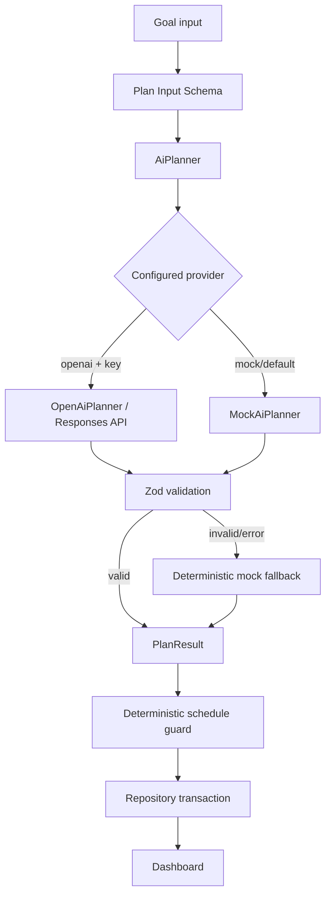

# QLEAR AI Orchestration

## Planning



## AiPlanner contract

- `createPlan(input)`: scope, Boss HP, exactly three quests, difficulties, estimates, damage, and schedule.
- `estimateDifficulty(input)`: rule/provider assessment from complexity, effort, dependencies, ambiguity, and context.
- `replan(input)`: exactly three editable next quests from completions, remaining HP, target date, time, and active route.
- `suggestAlternatives(input)`: up to three lower-friction routes with a reason.
- `createDailyReview(input)`: one concise review sentence and one next-action sentence.

## Deterministic mock

The mock hashes normalized goal text and classifies it as study, career, development, writing, personal, or general. Templates use the original goal in concrete ways; hash-based variants ensure equal input yields equal output. Scheduling is delegated to the shared fallback utility.

## OpenAI provider

The server-only adapter uses the Responses API and requests structured JSON. Model selection is centralized in `OPENAI_MODEL`. The browser never receives the API key. Missing configuration, transport errors, or schema failures fall back to the deterministic planner.

## Replanning

```text
Completion ledger + remaining HP + target date + daily minutes + active route
  -> ReplanInput validation
  -> provider
  -> PlanResult validation
  -> exactly-three guard / fallback
  -> editable plan confirmation
  -> repository replacement of uncleared route
```

## Trust model

Provider output is untrusted. Zod checks field types, allowed enums, limits, Boss bounds, subquest counts, and exactly three quests before persistence.

